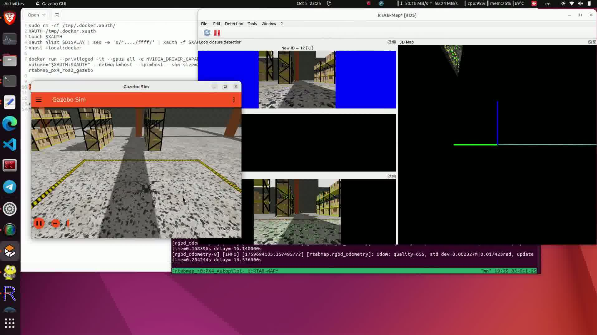
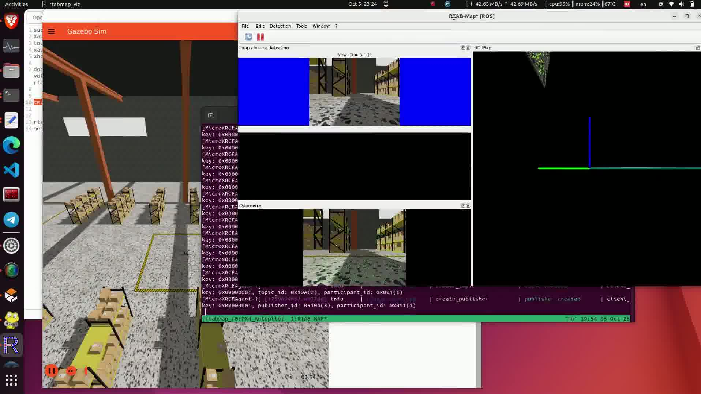
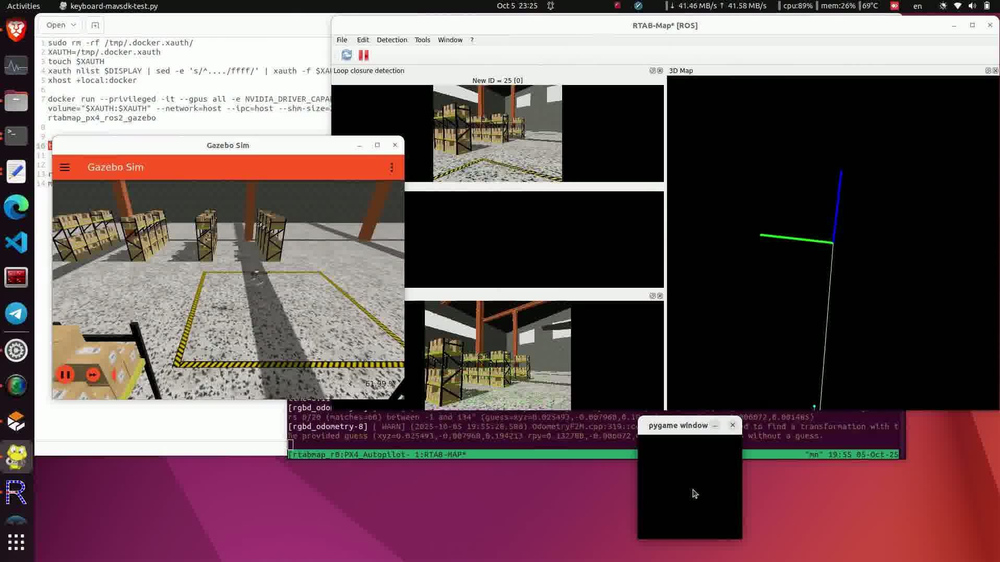
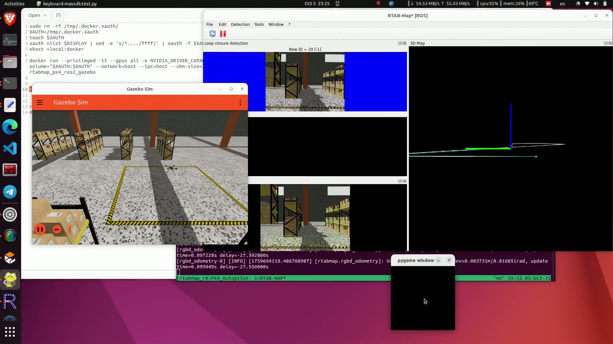
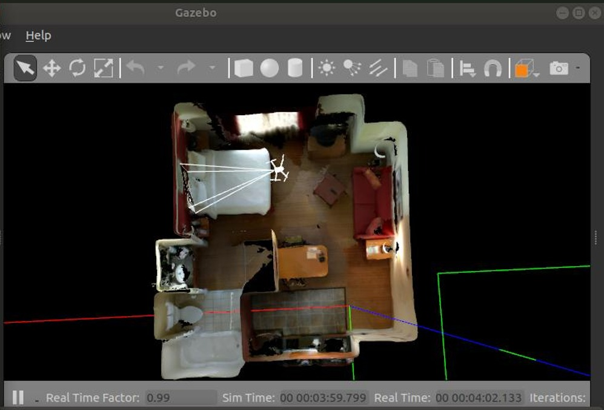
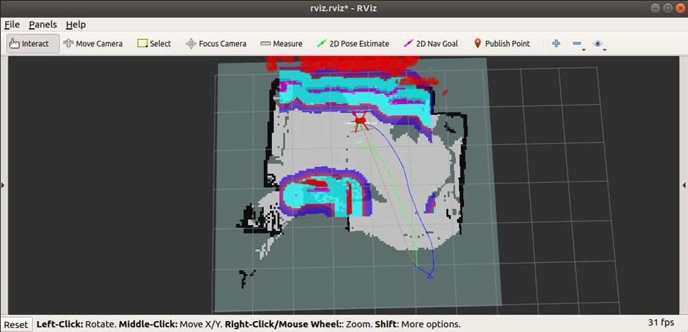

# Autonomous Drone Simulation with PX4, ROS 2, RTAB-Map SLAM and Nav2


A software-in-the-loop (SITL) simulation of an autonomous quadcopter. It uses the open-source **PX4 Autopilot** for flight control, **ROS 2** for the autonomy stack, **RTAB-Map** for RGB-D SLAM, and **Nav2** for autonomous navigation, all running in **Gazebo** indoor and warehouse worlds.

<p align="center">
  
</p>

---

## Project overview

The goal was to take a PX4 quadcopter from manual and mission-based flight to **autonomous indoor flight**: building a map of an unknown environment, localising in it, and navigating to goals while avoiding obstacles.

| Stage | What was done |
|---|---|
| 1. Environment setup | Cloned PX4-Autopilot and set up the ROS 2 workspace and Gazebo simulation inside a GPU-enabled Docker container |
| 2. PX4–ROS 2 bridge | Connected PX4 SITL to ROS 2 through the **Micro XRCE-DDS Agent**, using `px4_msgs` topics |
| 3. Offboard control | Armed the **x500** quadcopter and commanded take-off and setpoints from a ROS 2 offboard-control node |
| 4. Mission planning | Planned and monitored missions in **QGroundControl** |
| 5. Attitude control | Applied and tuned **PID** control on the roll, pitch and yaw loops for stable flight |
| 6. Manual teleoperation | Flew the drone from the keyboard with a Python **MAVSDK** script (pygame interface) |
| 7. SLAM | Ran **RTAB-Map** RGB-D odometry with loop-closure detection to build a 3D map of a warehouse world |
| 8. Autonomous navigation | Used the **Nav2** stack with global/local costmaps to plan and follow paths to goals set in RViz |

---

## System architecture

```
 QGroundControl ──(MAVLink)──┐
                             ▼
 MAVSDK keyboard teleop ──► PX4 Autopilot (SITL) ◄──► Gazebo (x500 + RGB-D camera, indoor / warehouse world)
                             ▲   attitude PID: roll / pitch / yaw
                             │
                  Micro XRCE-DDS Agent
                             │  px4_msgs (uORB ⇄ ROS 2 topics)
                             ▼
 ROS 2 ─► offboard control node  (arm, take-off, setpoints)
       ─► RTAB-Map               (RGB-D odometry, loop closure, 3D map, 2D occupancy grid)
       ─► Nav2                   (global + local costmaps, path planning, goal following)
       ─► RViz                   (visualisation, navigation goals)
```

---

## Tech stack

| Area | Tools |
|---|---|
| Flight control | PX4 Autopilot (SITL), x500 quadcopter model, PID attitude control |
| Middleware | ROS 2, Micro XRCE-DDS Agent, `px4_msgs` |
| Simulation | Gazebo Sim (warehouse world), Gazebo indoor world |
| SLAM | RTAB-Map (RGB-D odometry, loop-closure detection, 3D mapping) |
| Navigation | Nav2, costmaps, RViz goals |
| Ground control | QGroundControl, MAVSDK (Python) |
| Environment | Ubuntu, Docker with NVIDIA GPU passthrough, tmux |

---

## Results

### 1. Offboard take-off of the PX4 x500 in Gazebo Sim
The ROS 2 offboard-control node arms the drone and commands take-off.

▶️ [Watch the demo video](media/07_offboard_takeoff_x500_demo.mp4)

### 2. RTAB-Map SLAM in a warehouse world
PX4 runs in Gazebo Sim, bridged to ROS 2 through the Micro XRCE-DDS Agent. RTAB-Map's RGB-D odometry tracks the drone while loop-closure detection matches revisited places.

<p align="center">
  
</p>

| Loop-closure detection and 3D map | RGB-D odometry and trajectory |
|---|---|
|  |  |

### 3. Autonomous navigation with costmaps
In an indoor world, the drone builds a 2D occupancy map. The navigation stack inflates obstacles into costmaps and plans a global path (green) and a local trajectory (blue) to the goal set in RViz.

| Indoor Gazebo world | Costmaps and planned path in RViz |
|---|---|
|  |  |

---

## How the simulation was run (summary)

1. Start the Docker container with GPU and X11 access (`--gpus all`, `--network=host`).
2. Launch PX4 SITL with the x500 model in Gazebo (`make px4_sitl gz_x500`).
3. Start the Micro XRCE-DDS Agent to bridge PX4 and ROS 2 (`MicroXRCEAgent udp4 -p 8888`).
4. Run the ROS 2 offboard-control node to arm the drone and take off.
5. Launch RTAB-Map with the drone's RGB-D camera topics for SLAM.
6. Launch Nav2 and RViz, then send navigation goals.
7. Use QGroundControl for missions and monitoring, or the MAVSDK keyboard script for manual flight.

---

## What I learned
- How PX4 talks to ROS 2 through uORB topics and the Micro XRCE-DDS bridge.
- Offboard-mode requirements (setpoint streaming before arming, mode switching).
- Cascaded PID attitude control (roll, pitch, yaw) and how tuning affects stability.
- RGB-D SLAM: odometry quality, loop closure, and how drift is corrected.
- Costmap-based planning: global vs local planners and obstacle inflation.
- Running a full robotics stack reproducibly in Docker with GPU passthrough.

---

## Status
Simulation project (software-in-the-loop only, no physical drone). The original workspace files were not preserved, so this repository documents the setup, architecture and results with screenshots and video.

## Author
**Dhanush Anand** · [GitHub @dhanushanand-dev](https://github.com/dhanushanand-dev) · [LinkedIn](https://linkedin.com/in/dhanushanand-dev)
